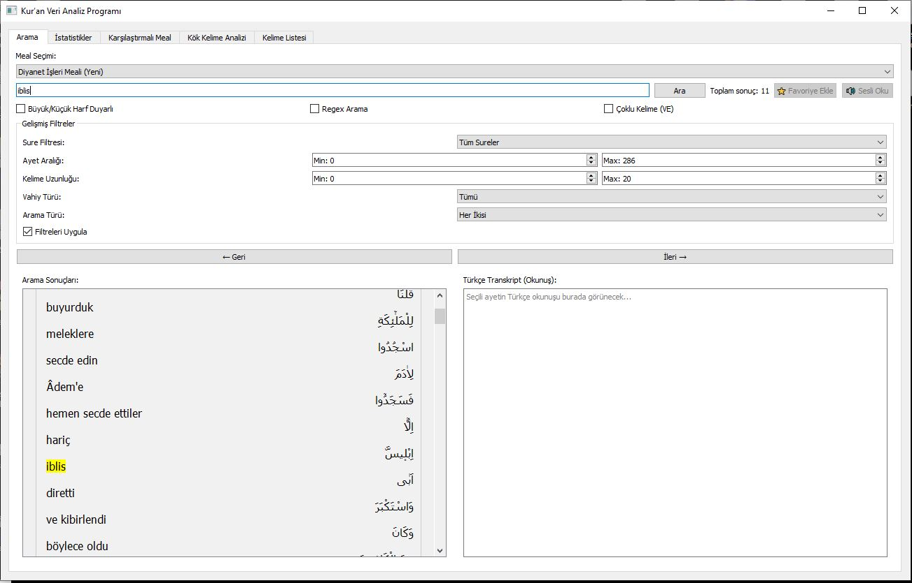
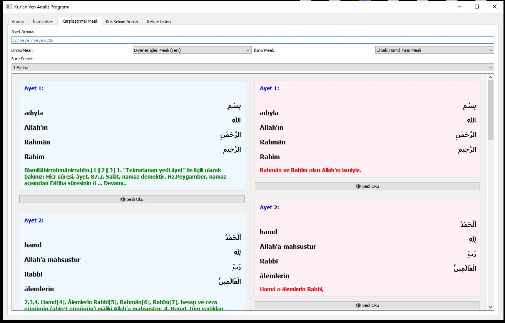
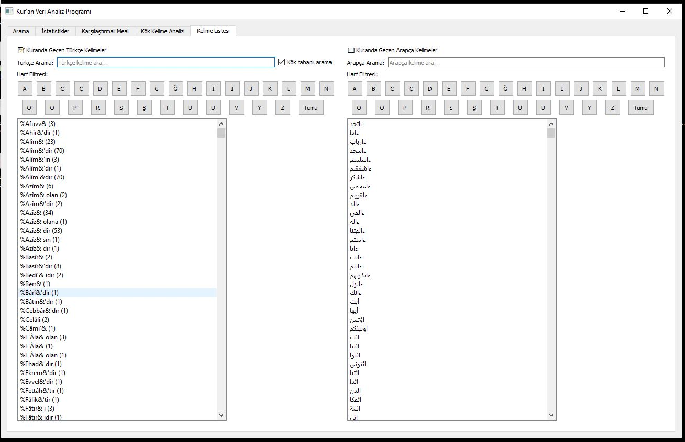

# Kur'an Veri Analizi

Kur'an metni üzerinde arama, kelime analizi ve meal karşılaştırma yapan bir masaüstü programı (Python + PyQt5).



## Özellikler
- **Arama:** Arapça ve Türkçe arama, büyük/küçük harf, regex ve çoklu kelime (VE) seçenekleri
- **Gelişmiş filtreler:** sure, ayet aralığı, kelime uzunluğu, vahiy türü
- **Türkçe okunuş:** seçilen ayetin Türkçe transkripti
- **İstatistikler** ve **kök kelime analizi**
- **Karşılaştırmalı meal:** iki meali yan yana okuma
- **Kelime listesi:** Kur'an'da geçen Türkçe ve Arapça kelimeler, harf filtresiyle
- **Favoriler** ve **sesli okuma** (TTS)




## Kurulum
```
pip install -r requirements.txt
python main.py
```

## Veri
`veriler/` klasöründe hazır gelir:
- `kelime_manali_kuran_ve_turkce_meali.json`: ayetler, kelime kelime anlamlar ve Diyanet meali
- `kurani_kerimdeki_tum_kelimeler.json`: tüm kelimeler ve Türkçe okunuşları

Diğer mealleri (50'den fazla meal: Elmalılı, Ateş, Yıldırım, Öztürk vb.) seçebilmek için isteğe bağlı olarak `veriler/tum_kuran_mealler.csv` dosyasını koyun (sütunlar: `sure`, `ayet`, `baslik`, `meal`). Telif hakları nedeniyle bu dosya depoda yoktur. Dosya yoksa program yine açılır ve sadece Diyanet mealiyle çalışır.

## Dosyalar
`main.py` ana program · `utils/veri_isleyici.py` veri yükleme ve metin düzeltme · `yardimci_araclar.py` metin vurgulama · `veriler/` veri · `screenshots/` ekran görüntüleri

## Lisans
Kod MIT lisanslıdır, bkz. [LICENSE](LICENSE). Bu lisans yalnızca kodu kapsar; meal metinlerinin hakları ilgili yazar ve kurumlara aittir.
